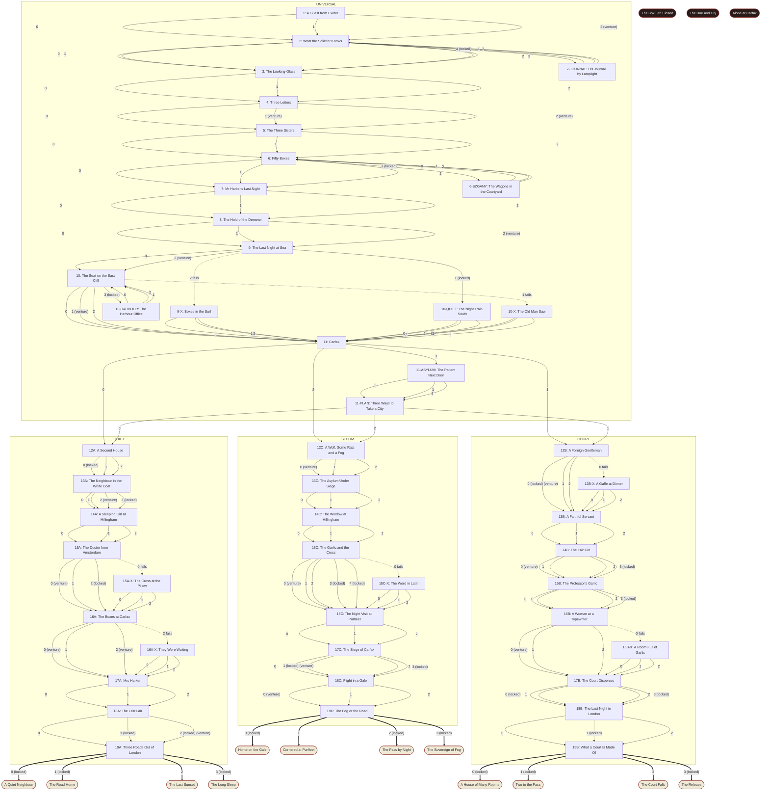

# Scene map: Dracula: The Passage

Generated by `scripts/scene_map.mjs` from the content files; do not edit by hand. `npm test` fails if it is out of date.

48 scenes, 15 endings. A scene is `id: title`; the number on an arrow is the option's position in the scene.

## Flags

| Flag | Set by (scene.option) | Read by | Note |
|---|---|---|---|
| `ambush` | 16A.2 | 17A (echo) | You waited in the dark and took a man at Carfax. |
| `aroundHim` | 15C-X.2 | 16C (echo) | You went round Van Helsing to the young men's windows. |
| `boxesLost` | 9.2 | 11 (echo) | The sea took boxes from the Demeter's hold. |
| `boxesShort` | 9-X.2 | 11 (echo), counter: Beds in England | You came to London twelve boxes short. |
| `brokeMirror` | 3.0 | 4 (echo) | You broke the looking-glass in front of him. |
| `burnedHand` | 16B-X.1 | 17B (echo) | The cross burned your hand. |
| `cameAsDog` | 9.0 | 10 (echo) | You came ashore at Whitby as a great dog. |
| `carfaxLost` | 16A.1, 17C.2 | 17A (echo), 18C (echo), gossip | You let the hunters have Carfax. |
| `carfaxSealed` | 16A.0, 16A.1, 16A.2, 17C.0, 17C.1, 17C.2, 17C.3 | counter: Beds in England | The hunters sealed Carfax. |
| `caughtShorthand` | 4.2 | 7 (echo) | You caught his line of shorthand. |
| `claimedBoxes` | 9-X.0 | 10 (echo) | You claimed the boxes from the harbour clerk. |
| `constableSaw` | 18A.2 | 19A (echo) | A constable at Jamaica Lane saw your cart and remembered it. |
| `copiedNames` | 2-JOURNAL.1 | 11 (echo) | You copied the English names from Harker's journal. |
| `courtDismissed` | 17B.1 | 18B (echo) | You let your court go. |
| `crewSpared` | 8.0 | 9 (echo) | You left the crew of the Demeter alone. |
| `crewTaken` | 8.1 | 9 (echo), epilogue, gossip | You took the Demeter's crew, one at a time. |
| `czarinaBooked` | 18A.0, 18B.2, 18C.1 | 19A.1 (lock) | You booked a berth in the Czarina Catherine. |
| `darkHouse` | 13A.1 | 14A (echo) | You kept Carfax in the dark. |
| `dinedWithSeward` | 13A.3 | 14A (echo) | You dined with Dr Seward as a foreign gentleman. |
| `doctorFriend` | 14B.3 | 15B (echo) | You made a friend of Lucy Westenra's doctor. |
| `dogsCalled` | 9-X.1 | 10 (echo) | You called every dog in Whitby to the beach. |
| `eastEndCellars` | 12A.2 | 18A.1 (lock) | You rented cellars in the East End in three names. |
| `fewBoxes` | 6.2 | 11 (echo), counter: Beds in England, counter: In the castle crypt | You shipped only twenty boxes. |
| `flowersRemoved` | 15B.0 | 16B (echo) | You had Lucy's mother take down the garlic. |
| `fogFirst` | 12C.2 | 13C (echo) | You called the fog first. |
| `fogLord` | 8.2 | 9 (echo) | You called the fog and the wind on the voyage. |
| `fogSiege` | 16B-X.2, 13C.1 | 17B (echo) | You besieged the house in fog. |
| `fogWalker` | 18A.2 | 19A (echo) | You changed cellars every night in the fog. |
| `forcedDinner` | 12B-X.1 | 13B (echo) | You forced down a dinner in Belgrave Square. |
| `forgedHand` | 4.1 | 7 (echo) | You forged his hand, and it passed. |
| `forgeryNoticed` | 4.1 | 7 (echo) | Mr Hawkins noticed the forgery. |
| `foughtAtCarfax` | 17C.0 | 18C (echo) | You fought for Carfax and lost it. |
| `fullHold` | 6.0 | 8 (echo), counter: Beds in England | You shipped all fifty boxes. |
| `gaffe` | 12B.0 | 13B (echo) | You were noticed at the opera for the wrong reason. |
| `gale` | 18C.0 | 19C.0 (lock) | You raised a gale on the Channel to cover your voyage. |
| `galeFailed` | 18C.0 | 19C (echo) | The gale you raised on the Channel failed you. |
| `gaveName` | 10-HARBOUR.2 | 11 (echo) | You gave your name at the Whitby harbour office. |
| `harbourWalked` | 10-HARBOUR.0, 10-HARBOUR.1, 10-HARBOUR.2 | 10.3 (shown when) | You went down to the harbour office at Whitby. |
| `harkerBlunted` | 1.2 | 4 (echo) | You made Mr Harker forget the road to the castle. |
| `harkerCross` | 1.2 | 7 (echo) | Mr Harker kept the old woman's crucifix. |
| `harkerDead` | 7.2 | 17A (echo), 16B (echo), 16C (echo), ENDING_1C (variant), epilogue, gossip | Mr Harker never went home. |
| `harkerFree` | 7.1 | 17A (echo), ENDING_3A (variant), gossip | You left Mr Harker's door open and the road clear. |
| `harkerLocked` | 7.0 | 17A (echo) | You left Mr Harker locked in, with the key to be found. |
| `heldBack` | 3.2 | ENDING_1D (variant), epilogue | You kept away from his blood. |
| `hostCool` | 1.1 | 3 (echo) | You received Mr Harker correctly and kept your distance. |
| `hostWarm` | 1.0 | 3 (echo), epilogue | You received Mr Harker as an honoured friend. |
| `houseInTrust` | 17B.3 | 18B (echo) | You put Carfax into a trust under Mr Billington's name. |
| `householdPassage` | 18B.1 | 19B.0 (lock) | You booked passage abroad for your household. |
| `journalSettled` | 2-JOURNAL.0, 2-JOURNAL.1, 2-JOURNAL.2 | 2.4 (shown when) | You spent a night with Harker's journal. |
| `knewTheHours` | 15B.3 | 16B (echo) | You learned the hours of Hillingham from a cabman and a milkman. |
| `knowsCity` | 2.2 | 18A.2 (lock), 15B.3 (lock), 17C.1 (lock) | You learned the streets and the river from Mr Harker. |
| `knowsDoctors` | 2.3 | 15A.2 (lock), 14B.3 (lock), 15C.4 (lock) | You learned from Mr Harker whom to avoid. |
| `knowsLaw` | 2.0 | 9.1 (lock), 12A.0 (lock), 17B.3 (lock), 17C.3 (lock) | You learned the law from Mr Harker. |
| `knowsManners` | 2.1 | 13A.3 (lock), 12B.0 (lock), 15C.3 (lock) | You learned English manners from Mr Harker. |
| `lastCourt` | 17B.2 | ENDING_2C (variant) | You lit Carfax for a last night with your servants. |
| `lastStand` | 18B.0 | 19B (echo) | You gathered your servants for a stand at Carfax. |
| `layLow` | 15A.1 | 16A (echo) | You kept your wolves and your face from the asylum. |
| `leftEarly` | 12B-X.2 | 13B (echo) | You left a dinner in Belgrave Square before the second course. |
| `leftJournal` | 2-JOURNAL.2 | 7 (echo) | You left Harker's journal unread. |
| `leftWhitby` | 10-X.2 | 11 (echo) | You left Whitby the night the old man saw you. |
| `letHimWin` | 15C-X.1 | 16C (echo) | You withdrew and let Van Helsing think he had won. |
| `lettersWritten` | 4.0 | 7 (echo) | Mr Harker wrote three letters for you. |
| `lucyAbandoned` | 14C.2 | 15C (echo) | You left Lucy Westenra to the doctors. |
| `lucyAtWindow` | 14C.0 | 16C (echo), epilogue | You sent the wolf through the window at Hillingham. |
| `lucyCourted` | 14B.0 | 15B (echo) | You courted Lucy Westenra. |
| `lucyLeftAlone` | 14B.2 | 15B (echo) | You left Lucy Westenra to her doctors. |
| `lucyMarked` | 10.1 | 14A (echo), 14B (echo), 14C (echo), gossip | You marked Lucy Westenra at Whitby. |
| `lucyOnce` | 14A.1 | 15A (echo) | You visited Lucy Westenra once. |
| `lucySpared` | 14A.0 | 15A (echo), epilogue | You left Lucy Westenra alone. |
| `lucyTaken` | 14A.2 | 15A (echo), gossip | You visited Lucy Westenra through the autumn. |
| `lucyTakenFast` | 14B.1 | 15B (echo), epilogue | You took Lucy Westenra quickly. |
| `lucyWary` | 14B.0 | 15B (echo) | Lucy Westenra wrote your name in her diary with a question mark. |
| `lyingLow` | 15A-X.0 | 16A (echo) | You lay low for a week after the dream failed. |
| `markedMina` | 10.2 | 14A (echo) | You watched Mina Murray at Whitby. |
| `metSeward` | 13A.2 | 15A (echo) | You called on Dr Seward and charmed him. |
| `metVanHelsing` | 15A.2 | 16A (echo) | You met Van Helsing as a stranger in a bookshop. |
| `minaListened` | 16B.0 | ENDING_2B (variant), epilogue | You told Mina Harker honestly what you were, and she listened. |
| `minaMarked` | 17A.2, 16B.1, 16B-X.1, 16C.0 | 19B.1 (lock), ENDING_2A (variant), gossip | You marked Mina Harker. |
| `minaRead` | 17A.1, 16B.2 | 18A (echo) | You read what Mina Harker had typed. |
| `minaScreamed` | 16B.0 | 17B (echo) | Mina Harker screamed, and the house woke. |
| `minaSpared` | 17A.0 | 18A (echo) | You left Mina Harker alone. |
| `minaSpoken` | 16C.1 | 17C (echo) | You spoke to Mina Harker and showed her what you were. |
| `mirrorsGone` | 3.1 | 4 (echo) | You had every mirror removed from the house. |
| `mistVisit` | 14C.1 | 15C (echo) | You visited Lucy Westenra as a mist. |
| `mistedOut` | 16A-X.0 | 17A (echo) | You gave the hunters an empty crypt, and hid in the wall. |
| `movedBoxes` | 16A.0, 17C.1 | 17A (echo), counter: Beds in England | You moved boxes out of Carfax the night before. |
| `movedFew` | 16A.0 | 17A (echo), counter: Beds in England | You got only four boxes out of Carfax before dawn. |
| `noticeServed` | 17C.3 | 18C (echo) | Mr Billington served notice on the hunters at Carfax. |
| `operaBox` | 12B.0 | 13B (echo) | You took a box at the opera. |
| `ownHours` | 12B-X.0 | 13B (echo) | You laughed off a bad moment at dinner as foreign custom. |
| `pageLost` | 10-HARBOUR.1 | 11 (echo) | You had a page of the Whitby harbour book spoiled. |
| `papersTaken` | 16C.2 | 17C (echo) | You took Mina Harker's typescript. |
| `passedWhitby` | 10.0 | 11 (echo) | You passed Whitby without being noticed. |
| `piccadillyBought` | 12A.0 | 18A.1 (lock), ENDING_1A (variant), gossip | You bought the house in Piccadilly by the book. |
| `piccadillyPaid` | 12A.1 | 18A.1 (lock), gossip | You paid a clerk to get the house in Piccadilly. |
| `policeSawCart` | 17C.1 | 18C (echo) | A policeman wrote down a cart in a lane, and a gentleman. |
| `ratSiege` | 13C.0 | 14C (echo) | You sent rats into the walls of the asylum. |
| `ratsAtCarfax` | 16A-X.1 | 17A (echo) | You put out the watcher's lantern with rats. |
| `ratsAtDoor` | 15C-X.0 | 16C (echo) | You sent rats and the wolf against Van Helsing's window while he wrote. |
| `ratsCalled` | 12C.1 | 13C (echo) | You called every rat in London. |
| `ratsSent` | 15A-X.2 | 16A (echo) | You sent rats to Van Helsing's room. |
| `readHarbourBook` | 10-HARBOUR.0 | 11 (echo) | You read the harbour clerk's book over his shoulder. |
| `readHisPaper` | 15C.4 | 16C (echo) | You read Van Helsing's own paper on the subject. |
| `readJournal` | 2-JOURNAL.0 | 10 (echo), 17A (echo) | You read Harker's journal through, in shorthand, while he slept. |
| `renfieldBound` | 11-ASYLUM.0 | 11-PLAN (echo), 13B (echo), gossip | You promised Renfield lives if he would watch the house. |
| `renfieldIgnored` | 11-ASYLUM.1 | 11-PLAN (echo), 13B (echo) | You ignored Renfield. |
| `renfieldKept` | 13A.0 | 14A (echo) | You kept Renfield quiet with small mercies. |
| `renfieldRefused` | 13B.2 | 14B (echo) | You refused Renfield's service. |
| `renfieldRescued` | 17B.0 | ENDING_2D (variant) | You took Renfield out of the asylum. |
| `renfieldSnubbed` | 11-ASYLUM.2 | 11-PLAN (echo), 13B (echo) | You told Renfield the Master was not coming. |
| `renfieldSteward` | 13B.0 | 17B.0 (lock) | You made Renfield your steward in the asylum. |
| `renfieldUsed` | 13B.1 | 14B (echo) | You used Renfield once, to open a door. |
| `reserveBoxes` | 6.1 | 11 (echo), 19A.3 (lock), counter: Beds in England, counter: In the castle crypt | You left ten boxes in the castle crypt. |
| `sawMinster` | 10-QUIET.2 | 11 (echo) | You walked round York Minster in the night. |
| `sentCard` | 15C.3 | 16C (echo) | You sent Van Helsing a courteous card. |
| `sewardWary` | 13A.2 | 15A (echo) | Dr Seward grew wary of you. |
| `showedFace` | 15A-X.1 | 16A (echo) | You showed Van Helsing your face at his window. |
| `sistersFed` | 5.1 | ENDING_3C (variant) | You took the sisters hunting on the hill pastures. |
| `sistersForbidden` | 5.0 | 7 (echo) | You forbade the sisters to touch him. |
| `sistersPromised` | 5.2 | ENDING_1B (variant) | You promised the sisters that he would be theirs. |
| `staredDown` | 16A-X.2 | 17A (echo) | You stared down the watcher in the crypt. |
| `stayedAway` | 15B.2 | 16B (echo) | You stayed away from the old man's flowers. |
| `stayedToFight` | 18C.2 | 19C (echo) | You decided to stay and finish the old man. |
| `stormRaised` | 8.2 | 9 (echo) | A gale you raised ran out of your hands. |
| `struckVH` | 15C.0 | 16C (echo) | You struck at Van Helsing and were turned back. |
| `swalesDead` | 10-X.1 | 11 (echo) | Old Mr Swales was found on his seat with his neck broken. |
| `swalesSaw` | 10.1 | 11 (echo) | Old Mr Swales saw you at the girl's window. |
| `swalesTalked` | 10-X.0 | 11 (echo) | You let old Mr Swales tell what he saw. |
| `szganyBound` | 6-SZGANY.1 | 8 (echo) | You frightened the Szgany into silence. |
| `szganyPaid` | 6-SZGANY.0 | 8 (echo), 19A (echo) | You paid the Szgany in gold. |
| `szganySettled` | 6-SZGANY.0, 6-SZGANY.1, 6-SZGANY.2 | 6.3 (shown when) | You settled the carrying with the Szgany in the courtyard. |
| `szganyTold` | 6-SZGANY.2 | 8 (echo) | You sat at the Szgany's fire and asked what the road says. |
| `threeFriends` | 12B.1 | 13B (echo) | You made friends of a solicitor, a banker and a doctor. |
| `triedHost` | 15C.1 | ENDING_3B (variant) | You laid your hand on the old man's bread. |
| `unnervedThem` | 15C.2 | 16C (echo) | You went for the young men's nerves. |
| `usedTheNight` | the adviser's remedy | ENDING_3D (variant), epilogue | You let the pack hunt for you. |
| `vhKnown` | 15A.0 | 16A (echo) | You learned how much Van Helsing knew. |
| `vhWoke` | 15A.0 | 16A (echo) | Van Helsing woke in his dream and turned you out. |
| `waited` | 13C.2 | 14C (echo) | You waited three nights and let them wonder. |
| `waitedAsked` | 12B.2 | 13B (echo) | You waited to be asked. |
| `warningSlipped` | 4.2 | 7 (echo) | A line of his shorthand reached Exeter. |
| `wentToGround` | 18A.1 | 19A (echo) | You went to ground in a cellar nobody knew. |
| `withdrewFromMina` | 16B-X.0 | 17B (echo) | You withdrew from Mina Harker for a week. |
| `wolfHeld` | 12C.0 | 13C (echo) | You held the wolf on a short lead. |
| `wolfLoose` | 12C.0 | 13C (echo) | The wolf slipped his lead and ran across the Heath. |
| `wolfSent` | 15B.1 | 16B (echo), epilogue | You sent the wolf through Lucy's window. |
| `wreckLanded` | 9.2 | 10 (echo) | You ran the Demeter onto the sand. |

