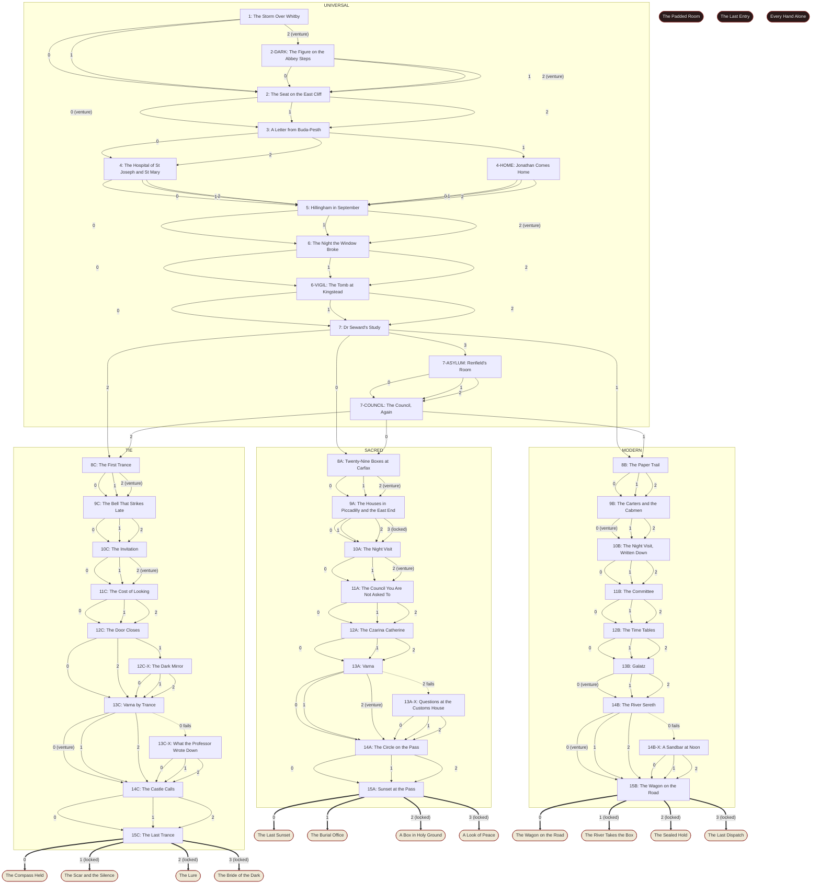

# Scene map: Dracula: The Harker Papers

Generated by `scripts/scene_map.mjs` from the content files; do not edit by hand. `npm test` fails if it is out of date.

40 scenes, 15 endings. A scene is `id: title`; the number on an arrow is the option's position in the scene.

## Flags

| Flag | Set by (scene.option) | Read by | Note |
|---|---|---|---|
| `aheadOfBarge` | 14B.0 | 15B (echo), ENDING_2B (variant) | The launch got three bends ahead of the barge. |
| `answeredCall` | 14C.1 | 15C (echo) | You answered the Count's call from the circle. |
| `arthurPrepared` | 6-VIGIL.1 | 7 (echo), epilogue | You prepared Arthur for the tomb. |
| `bellFound` | 9C.0 | 10C (echo) | You found the church with the slow clock at Bermondsey. |
| `bribedCustoms` | 13A-X.1 | 14A (echo) | You paid the customs officer at Varna. |
| `burnedPages` | 13C-X.2 | 14C (echo) | You burned the pages the Professor wrote down in your trance. |
| `calledHim` | 12C.1 | 13C (echo) | You called to the Count through the tie. |
| `carterTalked` | 9B.0 | 10B (echo) | A carter at Carter, Paterson's told you what he had seen. |
| `compromise` | 11A.2, 11B.2 | 12A (echo) | You agreed to keep the record and know the road, and not the hour. |
| `customsHold` | 13B.0 | 14B (echo), 15B.2 (lock), gossip | You got the box held under seal at Galatz. |
| `detectiveHired` | 8B.2 | ENDING_2D (variant) | You hired an inquiry agent. |
| `drankHisBlood` | 10A.2, 10C.2 | 11A (echo) | You drank the Count's blood. |
| `draughtGiven` | 10B.0 | 11B (echo) | Dr Seward gave you a draught to sleep. |
| `eastEndSealed` | 9A.1, 9A.3 | 11A (echo) | You helped seal the houses at Mile End and Bermondsey. |
| `excluded` | 11A.0, 11B.0 | 12A (echo) | You let the men leave you out of their plans. |
| `fedHim` | 12C-X.2 | ENDING_3C (variant) | You fed the Count lies through the tie. |
| `followedBarge` | 14B.1 | 15B (echo) | You followed the barge and noted every landing. |
| `followedShip` | 12C.0 | 13C (echo) | You followed the ship to Varna. |
| `foreheadBurned` | 10A.0, 10C.0 | 11A (echo), 15A (echo), 11C (echo), 14C (echo), ENDING_1A (variant), gossip | The Host left a mark on your forehead. |
| `fourParties` | 12B.0 | 13B (echo) | You sent four parties by the four quickest routes. |
| `gaveBlood` | 5.0 | 7 (echo), gossip | You gave Lucy your own blood. |
| `hailedIt` | 2-DARK.2 | 2 (echo) | You called out to the figure on the Abbey steps. |
| `heardHim` | 10C.1 | 11C (echo) | You listened to what the Count wanted. |
| `heardRavings` | 4.2, 4-HOME.2 | 5 (echo) | You learned what Jonathan raved about in his fever. |
| `heardSea` | 8C.0 | 9C (echo) | You heard water and timbers in the trance. |
| `heldTheCircle` | 14C.0 | 15C (echo) | You held the cross inside the circle for a night. |
| `hiredTow` | 14B-X.2 | 15B (echo) | You paid a farmer to tow the launch off the sandbar. |
| `hostCarried` | 11C.1 | 15C.1 (lock) | You kept the Host to hand during the trances. |
| `hostReserve` | 8A.1, 8A.2 | 15A.2 (lock), gossip | You kept some of the Host in reserve. |
| `hostSpent` | 8A.0 | 14A (echo), ENDING_1C (variant), gossip | You laid Host in every box at Carfax. |
| `householdKnows` | 2.1 | 3 (echo) | You woke the household, and the town learned that Lucy walks in her sleep. |
| `insisted` | 11A.1, 11B.1 | 12A (echo), 12B (echo) | You insisted on being told everything. |
| `jonathanScribed` | 13C.1 | 14C (echo) | Jonathan wrote down what you said in your sleep. |
| `keptRecords` | 9A.2 | 10A (echo) | You kept the records at the asylum while the others went out. |
| `keptSecret` | 8C.1, 12C-X.1 | ENDING_3A (variant) | You kept back what you heard in the trance. |
| `knowsBerth` | 13C.0 | 14C (echo) | You named the Count's berth at Varna before the ship docked. |
| `knowsRoute` | 13B.1 | 14B (echo) | You bought the bill of lading at Galatz. |
| `launchBought` | 12B.1 | 14B (echo), 15B.1 (lock), gossip | You bought a steam launch. |
| `leftItUnread` | 13C-X.1 | 14C (echo) | You asked the Professor not to tell you what he wrote down. |
| `lightenedLaunch` | 14B-X.0 | 15B (echo) | You threw the launch's stores overboard to get her off the sandbar. |
| `lucyLeft` | 3.0, 3.2 | 5 (echo) | You left Lucy to go to Jonathan. |
| `lucyWatched` | 3.2 | 5 (echo) | You asked Dr Seward and Arthur to look in on Lucy. |
| `married` | 4.0, 4.1, 4.2, 4-HOME.0, 4-HOME.1, 4-HOME.2 | 6 (echo) | You married Jonathan before the autumn. |
| `metCount` | 8A.2 | 10A (echo) | You saw the Count in the door of the chapel at Carfax. |
| `namedThem` | 14C.2 | 15C (echo), epilogue | You said the names of the people you love, on the pass. |
| `noticedMarks` | 2.0, 2.2 | 3 (echo), 5 (echo) | You saw the two marks on Lucy's throat and told yourself it was a pin. |
| `partLog` | 1.2 | 2 (echo) | You copied part of the Demeter's log before you were stopped. |
| `piccadillySealed` | 9A.0, 9A.3 | 11A (echo) | You helped seal the house in Piccadilly. |
| `prayedAllNight` | 14A.2 | 15A (echo), epilogue | You prayed all night on the pass. |
| `priestBlessed` | 13A.0 | 14A (echo), ENDING_1B (variant), gossip | A priest at Varna blessed the Host. |
| `pushedLaunch` | 14B-X.1 | 15B (echo) | You went over the side and pushed the launch off the sandbar. |
| `quayWatched` | 13A.1 | 14A (echo) | You watched the quay at Varna for two days. |
| `railParty` | 12A.0 | 13A (echo) | You went to Varna by rail with the Professor. |
| `readJournal` | 4.1, 4-HOME.1 | 5 (echo), epilogue, gossip | You read Jonathan's journal on your own, before the others knew. |
| `readLog` | 1.2 | 2 (echo) | You read the Demeter's log before the Board of Trade sealed it. |
| `readOwnWords` | 13C-X.0 | 14C (echo) | You read what the Professor wrote down in your trance. |
| `refusedHim` | 10A.2, 10C.2 | 11A (echo), 11B (echo) | You said your name to the Count and refused him. |
| `refusedHost` | 10A.1 | 11A (echo), ENDING_3B (variant) | You refused the Host the first night. |
| `renfieldTrusts` | 7-ASYLUM.0 | 7-COUNCIL (echo) | Renfield told you the door was not locked. |
| `rodeAhead` | 14B.2 | 15B (echo) | You rode ahead by road to reach the Pass first. |
| `satUp` | 10B.1 | 11B (echo) | You sat up all night with a revolver. |
| `sawBarge` | 13B.2 | 14B (echo) | You watched the barge go up the river. |
| `sawBox` | 9C.1 | 10C (echo) | You saw the Count's box in the second trance. |
| `sawCab` | 9B.1 | 10B (echo) | You noted the number of the cab that carried a box away at night. |
| `sawEmptyCoffin` | 6-VIGIL.2 | 7 (echo), epilogue | You saw Lucy's coffin empty by daylight. |
| `sawLucyUndead` | 6-VIGIL.0 | 7 (echo) | You saw Lucy walk, in the tomb, in her shroud. |
| `sawShape` | 2.0, 2-DARK.0, 2-DARK.2 | 2 (echo) | You saw the figure on the Abbey steps. |
| `sawWreck` | 1.1 | 2 (echo) | You watched them cut the dead captain from the Demeter's wheel. |
| `seaParty` | 12A.1 | 13A (echo) | You went after the ship by sea in a hired launch. |
| `sealedJournal` | 4.0, 4-HOME.0 | 7 (echo), epilogue, gossip | Jonathan's journal stayed sealed until you needed it. |
| `sealedLairs` | 12C.2 | 13C (echo) | You sealed the last of the Count's lairs in England. |
| `secretTrances` | 11C.2 | 12C (echo), epilogue, gossip | You went under in secret, alone, at night. |
| `shipSealed` | 13A.2 | 14A (echo) | You sealed the hold of the Czarina Catherine with the Host. |
| `slippedOut` | 13A-X.2 | 14A (echo) | You slipped out of the customs house while the Professor held the officer. |
| `spokeToBrides` | 14A.1 | ENDING_1D (variant) | You spoke to the Brides through the night. |
| `stayedWithLucy` | 3.1 | 5 (echo) | You stayed with Lucy and sent a clerk for Jonathan. |
| `storyTold` | 13A-X.0 | 14A (echo) | You told the officer at Varna a dull story and were believed. |
| `telegramNet` | 8B.1 | 15B.3 (lock), ENDING_2C (variant), gossip | You sent twenty-six telegrams down the Thames. |
| `tieDeep` | 8C.2, 9C.1, 10C.1, 10C.2, 11C.2, 12C.1, 14C.1 | 14C (echo), 15C.2 (lock), 15C.3 (lock), gossip | The tie with the Count went deep. |
| `timetableKept` | 11B.1, 11B.2, 12B.0 | 15B.3 (lock) | You kept the timetable. |
| `toldArthur` | 6.2 | 6-VIGIL (echo) | You told Arthur about Lucy yourself. |
| `tookRemedy` | the adviser's remedy | ENDING_3D (variant), epilogue | You took the Professor's remedy. |
| `tranceGuarded` | 8C.2, 9C.2, 11C.1 | 9C (echo) | You woke yourself from the trance, or kept the sessions guarded. |
| `tranceOpen` | 8C.0, 8C.1, 9C.1 | 12C (echo) | You told the Professor everything you saw in the first trance. |
| `tranceStopped` | 11C.0, 13C.2 | 12C (echo) | You put the thread away and stopped the trances. |
| `typedRecord` | 8B.0, 9B.2, 10B.2 | 12B (echo), ENDING_2A (variant), gossip | You kept the typed record of the hunt. |
| `wholeParty` | 12A.2, 12B.2 | 13A (echo), 13B (echo) | You travelled with the whole party, in one train. |
| `windowOpened` | 5.2 | 6 (echo) | Mrs Westenra opened the window against advice. |
| `windowShut` | 5.2 | 6 (echo) | You persuaded Mrs Westenra to keep the window shut. |
| `wreathKept` | 5.1, 5.2 | 6 (echo) | You kept the garlic in Lucy's room. |
| `wroteRefusal` | 12C-X.0 | 13C (echo) | You refused the Count aloud and wrote it down. |

